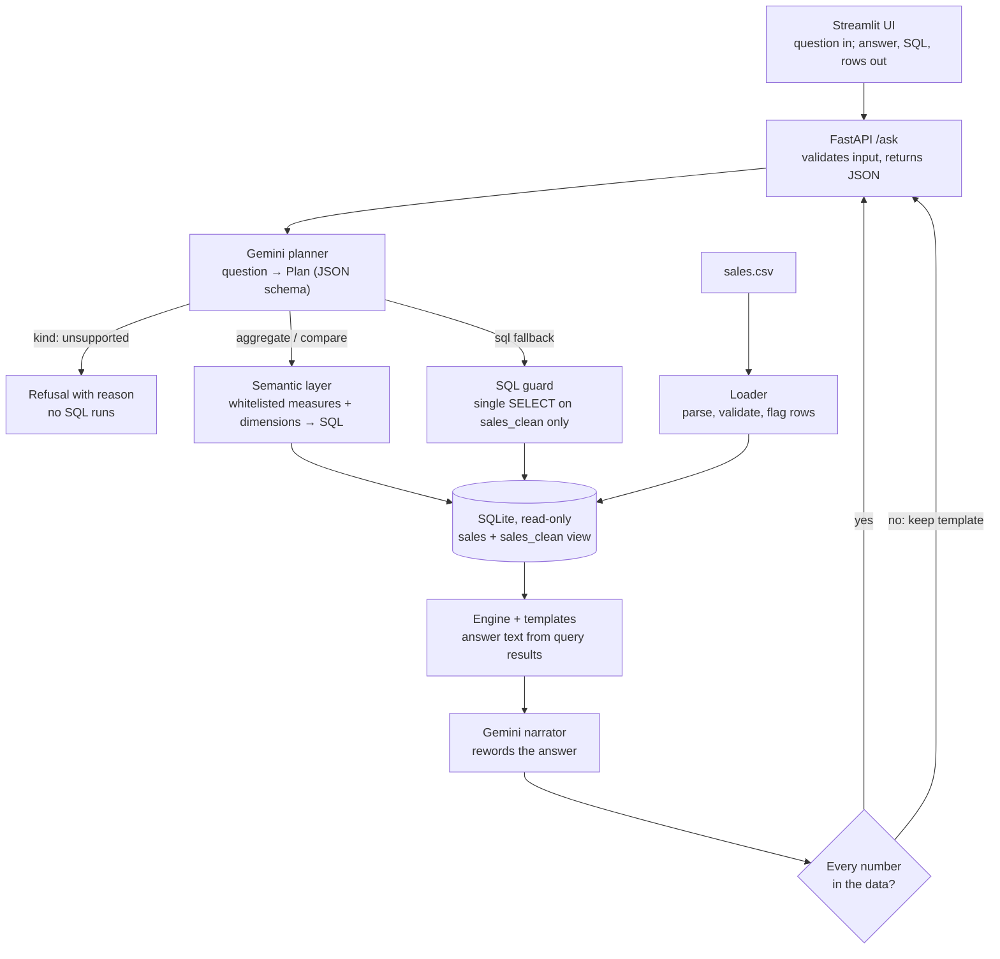

# Architecture

The LLM decides **what** to compute. Application code decides **how**, and produces every number.



## Components

| Module | Responsibility |
|---|---|
| `db.py` | Loads the CSV, flags bad rows, creates the `sales` table and `sales_clean` view, opens read-only connections, enforces a query timeout |
| `catalog.py` | Reads the distinct products, categories, regions, channels and months that exist |
| `planner.py` | Sends the question to Gemini with the schema and catalog in the system prompt; parses and validates the JSON plan |
| `semantic.py` | The `Plan` model and the only place SQL is assembled for normal questions |
| `sql_guard.py` | Validates AI-written SQL for the fallback path |
| `engine.py` | Checks the plan against real values and runs the query |
| `answers.py` | Templates that turn results into sentences, numbered lists and bullets |
| `narrator.py` | Optional Gemini rewording of the answer; rejected if it contains any number not in the data |
| `main.py` | HTTP layer: request validation, error codes, logging |

## Storage

```
sales        every CSV row: cleaned fields + is_valid + reject_reason (+ raw date for auditing)
sales_clean  view: is_valid = 1 AND status = 'Completed', adds month and revenue
```

Analytics never read `sales` directly, so the cleaning rules are defined once.

## Request lifecycle

Example: "How did revenue change between April and May?"

1. FastAPI validates the body (non-empty, at most 500 characters).
2. Gemini returns `{"kind": "compare", "measure": "revenue", "period_a": "2026-04", "period_b": "2026-05"}`.
3. Pydantic validates the plan (enums, month format, period_a ≠ period_b).
4. The engine confirms both months exist in the data.
5. `semantic.py` builds `SELECT month AS label, SUM(revenue) AS value ... WHERE month IN (?, ?)`.
6. SQLite returns 240,700 and 318,500. Python computes +77,800 (+32.3%).
7. The response contains the answer, the plan, the SQL and its parameters, and the supporting rows.

## Plan kinds

| Kind | Used for | Safety |
|---|---|---|
| `aggregate` | Totals, rankings, breakdowns, trends, filtered views | SQL built from whitelists, values bound as parameters |
| `compare` | Change in one measure between two months | Same as above |
| `sql` | Answerable questions that don't fit the shapes above | Guard + read-only connection + timeout; answer marked unverified |
| `unsupported` | Data the table doesn't have, off-topic questions, requests to change data | Nothing runs |

## Mapping to AI concepts

- **Generative AI:** used for language only: understanding the question (question to plan) and wording
  the answer. Facts come from SQL, and a number check rejects any rewrite that changes them.
- **Agentic AI:** the model chooses which "tool" (plan kind) to use. A multi-step version would let it
  chain plans, for example "why did May spike?" as a month comparison followed by a breakdown by region.
- **Vectorless RAG:** the context retrieved for the prompt is structured metadata from the database
  (columns, real product and region names, available months). There are no embeddings and no vector store.
